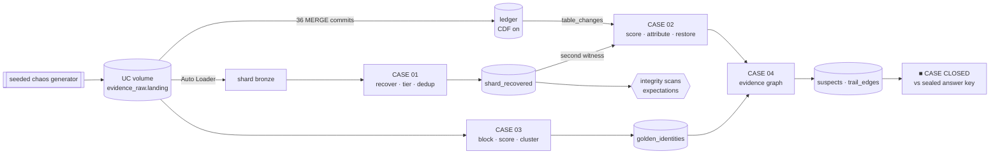

<div align="center">

# ▓ NEO-DANUBE · DATA FORENSICS UNIT

**A Databricks lakehouse where every pipeline is an investigation.**

`Auto Loader` · `Delta time travel` · `Change Data Feed` · `Entity resolution` · `Unity Catalog` · `Lakeflow expectations` · `Asset Bundles`

[**▶ Open the Forensics Terminal (interactive walkthrough)**](https://YOUR-SITE.netlify.app) · [Case briefings](lore/) · [Notebooks](notebooks/)

</div>

---

> *Neo-Danube, March 2077. Halcyon Dynamics, the megacorp that runs the city's water, power and
> transit, has been breached from the inside. Someone stole a copy of the central ledger, spent two
> weeks rewriting history inside it, and vanished behind a dozen fake identities.*
>
> *You're the analyst on duty at the Data Forensics Unit.*

This is a portfolio project and a **learning resource**. Each "case" is a real data engineering
problem dressed as an investigation, with its own notebook, tested Spark code, a check-yourself quiz,
and an interactive page on the showcase site.

## The cases

| | Case | The data problem | Databricks features |
|---|---|---|---|
| 01 | **Shard Recovery** *"Ghost in the Bytes"* | Ingest damaged files: schema drift, mistyped values, truncated JSON, latin-1, misaligned CSV, duplicates | Auto Loader, `_rescued_data`, `columnNameOfCorruptRecord`, `binaryFile` + `decode`, window dedup |
| 02 | **The Tamper** *"Someone Rewrote History"* | Find malicious edits among 36 commits of honest work, then undo only them | `DESCRIBE HISTORY`, time travel, Change Data Feed, `SHALLOW CLONE`, `RESTORE` vs surgical `MERGE` |
| 03 | **Ghost Identities** *"Who's the Real Merc?"* | Resolve ~80 records from 4 systems into real people | Normalization, blocking keys, `levenshtein`/`soundex` scoring, label-propagation clustering |
| 04 | **The Trail** *"Follow the Money"* | Join every finding into an evidence graph and name the network | Edge tables, multi-hop joins, optional `ai_query()` case report |
| ◆ | **Clearance levels** | Govern the evidence | UC tags, column masks, row filters, lineage, `system.access.audit` |
| ✓ | **Integrity scans** | Certify evidence before it's used | Lakeflow Declarative Pipeline expectations (warn / drop / fail) |
| ■ | **Case closed** | Prove the answer | Grades the run against a sealed answer key; a wrong answer fails the job |

## How it fits together



**Unity Catalog layout:** one catalog, five schemas: `evidence_raw` (bronze), `evidence_processed`
(silver), `case_findings` (gold), `quarantine`, `ops`.

## A new case every run

The generator (`src/dfu/generator`) is pure Python and seeded, so the same seed gives the same crime
and a new seed gives a new one. Difficulty controls the noise:

| Difficulty | People | Culprit aliases | Night-shift noise | Shard damage |
|---|---|---|---|---|
| `street_kid` | 24 | +1 | low | 15% |
| `corpo` | 36 | +2 | normal | 25% |
| `nomad` | 48 | +3 | high | 35% |
| `legend` | 64 | +4 | very high | 45% |

Every scenario is **guaranteed solvable**: aliases are re-rolled until they still match their owner,
and the test suite checks 12 seed × difficulty combinations end to end.

## Run it

**On Databricks (bundle):**
```bash
databricks bundle deploy -t dev
databricks bundle run dfu_investigation -t dev --params seed=42,difficulty=nomad
```
Or open the notebooks in a Git folder and run them in order: `setup/01`, `setup/02`, `cases/01` → `05`,
then `governance/clearance_levels.sql`.

**Free Edition:** set the `catalog` widget to a catalog you own (e.g. `workspace`) and, if Auto
Loader isn't available, set `use_autoloader = false` on Case 01. A fallback produces the same columns.

**Locally (no Databricks):**
```bash
pip install -r requirements-dev.txt
python -m dfu.generator --seed 2077 --difficulty legend --out ./landing   # from src/
pytest -q                                                                   # runs all cases on local Spark
```

## Design decisions

- **Logic in `src/`, narrative in notebooks.** Every transformation is a pure `DataFrame → DataFrame`
  function, imported by the notebooks *and* the tests. The notebooks do I/O and explanation only.
- **Never silently invent data.** Recovered records carry a tier and the list of repairs applied. A
  truncated amount (`"amount": 360` cut off) stays `null` instead of becoming a wrong `360.0`.
- **Weak signals can't convict.** Tamper scoring separates strong evidence (redirects, backdating,
  deleted audit flags, contradiction with the stolen original) from weak hints (night edits, round
  numbers). The generator plants an honest night shift to punish naive rules.
- **Surgical restore over `RESTORE`.** Rolling the table back would erase two weeks of honest work. The
  notebook proves it on a shallow clone, then restores only the tampered rows from CDF pre-images.
- **No GraphFrames, no UDFs.** Clustering is label propagation in plain Spark, so it runs on serverless.
- **Tests grade the detective, not just the code.** `05_case_closed` and the pytest suite compare
  results against the sealed answer key, so a regression that lets the culprit escape fails CI.

## Repo map

```
src/dfu/generator/      seeded breach generator (stdlib only)
src/dfu/forensics/      reference rules in plain Python (matching, tamper scoring)
src/dfu/spark/          the Spark implementation of every case
notebooks/setup/        build the crime scene
notebooks/cases/        01-04 + case closed
notebooks/governance/   tags, masks, row filters, audit
pipelines/              Lakeflow integrity scans
resources/              bundle job + pipeline
tests/                  pytest, incl. full pipeline on local Spark
tools/                  export one scenario for the showcase site
site/                   the Forensics Terminal (static, Netlify-ready)
lore/                   case briefings
```

## Showcase site

`site/` is a single static page with no build step. It walks through every case with live visuals:
the shard reconstructor, a time scrubber across Delta versions, a draggable identity web with a
threshold slider, the money trail, and a clearance-level toggle. Deploy by dragging the folder into
Netlify, or connect the repo (the included `netlify.toml` publishes `site/`).

Regenerate its data for another seed: `python tools/export_site_data.py --seed 42 --difficulty nomad`.

---

<sub>All people, companies and places are fictional. Neo-Danube is an invented city; any
resemblance to real people is coincidental and generated by a random seed.</sub>
